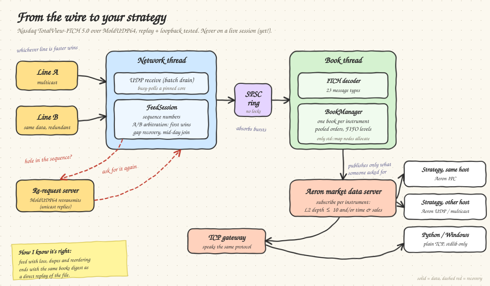

# ITCH Market Data Adapter

A Nasdaq **TotalView-ITCH 5.0** market data adapter in C++20. It takes ITCH over **MoldUDP64** (two redundant
lines, gap recovery, mid-day join), decodes it, maintains a full order book per instrument, and distributes
L2 depth and time & sales to strategy processes over **Aeron** (or a TCP gateway for Python/Windows clients).

> **Status.** Built and tested end to end against the free 2019-12-30 Nasdaq sample day
> and against a simulated faulty MoldUDP64 feed on loopback. **It has never been connected to a live exchange
> session**, and the Linux tuning advice in [docs/performance.md](docs/performance.md) has not been run on Linux
> hardware. Development and all measurements were on an Apple M2.



| Stage | What it does | Details |
|---|---|---|
| Decoder | All 23 ITCH 5.0 message types, big-endian, 6-byte nanosecond timestamps | [spec](docs/spec/NQTVITCHSpecification.pdf) |
| Feed | MoldUDP64 sequencing, A/B arbitration, adaptive-timeout gap recovery, session lifecycle, catch-up from seq 1 | [docs/feed.md](docs/feed.md) |
| Order book | Pooled orders, open-addressing ref index, FIFO price levels, per-instrument L2 and trade events | `include/itch/book/` |
| Messaging | Per-instrument subscriptions (L2 depth ≤ 10, time & sales), IPC / UDP unicast / multicast, TCP gateway | [docs/messaging.md](docs/messaging.md) |

## Requirements

- A C++20 compiler (Clang or GCC), **CMake ≥ 3.21** (presets), **Boost ≥ 1.74** headers.
- Internet access on first configure: spdlog (if not installed) and Aeron 1.53.3 are fetched by CMake.
  Offline, use `-DITCH_AERON_SOURCE_DIR=/path/to/aeron` or the `no-aeron` preset.
- Optional: folly (detected automatically), Python 3 for the pure-Python client and its test.
- macOS and Linux. Windows is supported for the **Python client only**.

```sh
brew install cmake boost                       # macOS
sudo apt install cmake libboost-dev g++ git    # Debian/Ubuntu
```

## Build and test

```sh
cmake --preset release
cmake --build --preset release -j
ctest --preset release                         # 20 tests
```

Binaries land in `build/release/`. Other presets: `release-native` (CPU-tuned + LTO), `profile`, `no-aeron`,
`debug`, `asan`, `tsan`. See [docs/performance.md](docs/performance.md) for which to use when.

CMake options: `ITCH_NATIVE`, `ITCH_LTO`, `ITCH_SANITIZE`, `ITCH_TSAN`, `ITCH_WITH_AERON`,
`ITCH_AERON_SOURCE_DIR`, `ITCH_BUILD_TESTS`.

## Get data

The free sample day is about 3.5 GB compressed:

```sh
scripts/fetch_sample.sh            # -> data/12302019.NASDAQ_ITCH50.gz  (resumable; verifies with gzip -t)
```

The file is Nasdaq's, published at <https://emi.nasdaq.com/ITCH/Nasdaq%20ITCH/>. `data/` is git-ignored.

## Use it

All tools print `--help`-style usage on bad arguments. Paths below assume `build/release/`.

**1. Decode a file and check the decoder**

```sh
gzip -dc data/12302019.NASDAQ_ITCH50.gz | build/release/itch_file_replay -n 1000000
```

**2. Build the books from a file and look at them**

```sh
gzip -dc data/12302019.NASDAQ_ITCH50.gz | build/release/itch_book_replay \
    --until 09:30:00 --show AAPL,MSFT --depth 5 --digest
# --verify checks every update against an independent reference model (slow); --validate-every N checks structure
```

**3. Run the live path on loopback** (a sender stands in for Nasdaq, with injectable faults)

```sh
# terminal 1: replay the sample as MoldUDP64 on two lines, with loss/duplication/reordering, and serve re-requests
gzip -dc data/12302019.NASDAQ_ITCH50.gz | build/release/itch_mold_sender \
    --a 127.0.0.1:30011 --b 127.0.0.1:30012 --rerequest-port 40500 --rate 300000 --max-messages 3000000 \
    --loss 0.05 --dup 0.02 --reorder 0.1:3

# terminal 2: the adapter
build/release/itch_feed_handler --a 127.0.0.1:30011 --b 127.0.0.1:30012 --rerequest 127.0.0.1:40500 --digest
```

With faults on, the handler's final `books digest` equals the one `itch_book_replay -n 3000000 --digest` prints
for a direct replay. That is the end-to-end correctness check. More in [docs/feed.md](docs/feed.md).

**4. Serve books to strategies over Aeron**

```sh
# server: preload to 10:00 ET, then 200k msg/s (embedded media driver; see docs/performance.md for aeronmd)
gzip -dc data/12302019.NASDAQ_ITCH50.gz | build/release/itch_md_server --preload-until 10:00:00 --rate 200000

# same-machine client (IPC): L2 depth 10 and time & sales
build/release/itch_md_client --symbols AAPL,MSFT --l2 10 --tns

# client on another machine (UDP unicast); --reply-host is its own address as the server sees it
build/release/itch_md_client --server 10.0.0.1 --reply-host 10.0.0.7 --symbols AAPL --l2 5
```

The live adapter can serve directly with `itch_feed_handler ... --serve`.

**5. Python or Windows client** (no Aeron needed; stdlib only)

```sh
build/release/itch_md_gateway --listen 0.0.0.0 --port 40200 --allow 10.0.0.0/24      # on the server
python clients/python/itch_md_client.py --host 10.0.0.1 --port 40200 --symbols AAPL --l2 5     # on the client
```

Check the client README for the exact flags: [clients/python/README.md](clients/python/README.md).
The server enforces an IP allow-list and validates channel strings; see the security section of
[docs/messaging.md](docs/messaging.md).

## Running it fully optimised

Short version: build with `cmake --preset release-native` (and *measure* whether it helps on your CPU: on the M2 it
did not), size `--expect-orders`, `--ring-mb` and `--rcvbuf-mb` for your feed, pin the network thread with `--cpu` on
an isolated core, run a standalone `aeronmd` on its own cores, and tune the Linux host (isolated cores, IRQ affinity,
NIC ring and coalescing, socket buffer sysctls, huge pages). Every setting, with what was **measured here** versus
what is **recommendation only**, is in **[docs/performance.md](docs/performance.md)**.

## Repository layout

| Path | Purpose |
|---|---|
| `include/itch/`, `src/` | Libraries: `protocol/`, `book/`, `net/`, `feed/`, `messaging/` |
| `tools/` | Executables: file/book replay, MoldUDP64 sender, feed handler, md server/client/gateway |
| `clients/python/` | Pure-Python client (Windows / macOS / Linux) |
| `tests/` | Unit, golden (spec-derived), property, integration, Python; a deterministic feed simulator |
| `scripts/` | `fetch_sample.sh` |
| `docs/` | `feed.md`, `messaging.md`, `performance.md`, `spec/` (Nasdaq PDFs) |
| `data/` | Sample files (git-ignored) |

## Testing

`ctest --preset release` runs unit, golden, property, differential and integration tests (the Aeron integration
test needs a build with Aeron). Use the sanitizer presets before trusting a change:

```sh
cmake --preset asan && cmake --build --preset asan -j && ctest --preset asan    # address + undefined behaviour
cmake --preset tsan && cmake --build --preset tsan -j && ctest --preset tsan    # data races (Aeron off)
```

What each test covers and how the fault-injection runs work: [docs/feed.md](docs/feed.md#verification) and
[docs/messaging.md](docs/messaging.md#tests).

## Known limits

Not production-ready. In particular: no live-exchange connectivity or certification; no kernel-bypass receive;
price levels use `std::map` (the one remaining source of hot-path allocation); the re-request path assumes the
server replies with messages that fit one UDP packet. Full lists in [docs/feed.md](docs/feed.md#limits) and
[docs/messaging.md](docs/messaging.md#known-limits).

## References

- [Nasdaq TotalView-ITCH 5.0 specification](docs/spec/NQTVITCHSpecification.pdf) and [MoldUDP64 specification](docs/spec/MoldUDP64.pdf) (bundled copies; Nasdaq owns them)
- [Nasdaq ITCH sample data](https://emi.nasdaq.com/ITCH/Nasdaq%20ITCH/)
- [Aeron](https://github.com/aeron-io/aeron) and its [configuration options](https://github.com/aeron-io/aeron/wiki/Configuration-Options)
- [Boost.Asio](https://www.boost.org/doc/libs/release/doc/html/boost_asio.html), [spdlog](https://github.com/gabime/spdlog), [CMake presets](https://cmake.org/cmake/help/latest/manual/cmake-presets.7.html)

## License

No license has been chosen yet; until one is added, all rights are reserved. The bundled Nasdaq PDFs are not
covered by any license of this project.
